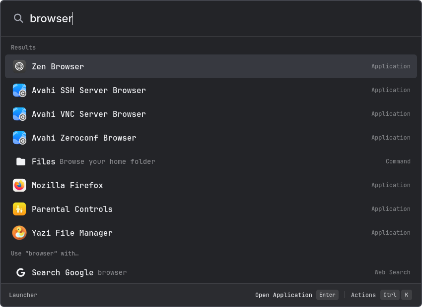

# KITE

A keyboard-friendly Linux launcher for apps, calculations, emoji, clipboard history and open windows.



## Setup with uv

### 1. Install system dependencies

You need **system Python 3.14+**, Git, [uv](https://docs.astral.sh/uv/getting-started/installation/), PyGObject/Gio and `xdg-utils`.

**Qt is required.** The installer supplies **PySide6-Essentials and its bundled Qt libraries/platform plugins** through uv. Your system still needs the native display, keyboard, font, D-Bus and OpenGL/EGL libraries used by Qt.

On **Arch Linux / Manjaro**, install the basics and those Qt runtime dependencies:

```sh
sudo pacman -S --needed python python-gobject git uv xdg-utils \
  libglvnd libx11 libxkbcommon-x11 xcb-util-cursor xcb-util-wm \
  xcb-util-keysyms wayland fontconfig dbus
```

On other distributions, install the equivalent Gio and Qt display-runtime libraries and confirm your system Python is 3.14 or newer. A separate system PySide package is not needed; uv installs the pinned version.

### 2. Install KITE

```sh
git clone https://github.com/Kabil777/kite.git
cd kite
bash install.sh
```

Run the installer as your normal user, **not with sudo**. It creates the Python environment, `~/.local/bin/kite` and a desktop-menu entry. Existing settings and installed plugins are preserved.

### 3. Open it

```sh
~/.local/bin/kite
```

Type an app name, choose a result with **↑ / ↓**, and press **Enter**. **Escape** goes back or closes the main window. **Ctrl+K** opens Actions; **Ctrl+?** opens help.

Bind `~/.local/bin/kite` to your preferred shortcut in your desktop's keyboard settings. Running it again toggles the existing window closed.

## Optional features

| Feature | What to add |
| --- | --- |
| Copy on Wayland | `wl-clipboard` |
| Copy on X11 | `xclip`, or text-only `xsel` |
| Clipboard history | `cliphist` and a compatible watcher configured by you |
| Window switching | The [helper for your desktop](docs/desktop.md) |
| Rust search | Follow the [optional Rust setup](examples/rust-ranking/HOWTO.md); Python search is the default |
| Extra plugins | Browse the [plugin registry](https://github.com/Kabil777/kite_plugins) and follow the plugin's README |

**No external plugin is installed by default.** For example, [Passwords/Gopass](https://github.com/Kabil777/kite_plugins/tree/main/plugins/gopass) is a separate, opt-in package—not part of the KITE installation.

To browse marketplace releases, use **Plugin marketplace → Configure** with:

```text
https://raw.githubusercontent.com/Kabil777/kite_plugins/main/index.json
```

The marketplace catalog is currently empty; source-install instructions are listed in the registry. Review plugin code and requirements before enabling it.

## Settings and help

Settings are in `~/.config/kite/config.yaml`. You can keep the defaults; see [settings](docs/settings.md) only when you want to customize something.

- [User guide](docs/howto.md): tools, shortcuts and everyday troubleshooting.
- [Copy and paste](docs/clipboard.md): clipboard backends and history setup.
- [Development](docs/development.md): source setup and test commands.
- [Plugin authors](docs/plugins.md): API details and custom tools.

## Update

Close KITE, return to your checkout, then run:

```sh
git pull --ff-only
bash install.sh
```

## If it does not start

- **Qt says the `xcb` platform plugin cannot load:** install the Qt runtime packages above, especially `xcb-util-cursor`, `xcb-util-wm`, `xcb-util-keysyms` and `libxkbcommon-x11` on Arch/Manjaro.
- **Python cannot import `gi`:** install matching system PyGObject/Gio bindings. The environment must use system Python with system site-packages; see [development setup](docs/development.md#get-a-working-checkout).
- **Copy fails:** install the copy tool for your session; see [clipboard setup](docs/clipboard.md).

[Icon credits](assets/icons/README.md) · [Architecture](docs/core.md) · [Extension reference](docs/extensions.md) · [Rust matcher license/provenance](examples/rust-ranking/PROVENANCE.md)
